<div align="center">


# MyProxmox

Une interface web simple pour Proxmox VE, avec un écran de monitoring, des alertes et un serveur MCP pour Claude.

[](LICENSE)


[Démo en ligne](https://myproxmox.vercel.app) · [Installation](#installation) · [Claude et MCP](docs/MCP.md) · [English](#in-english)

</div>

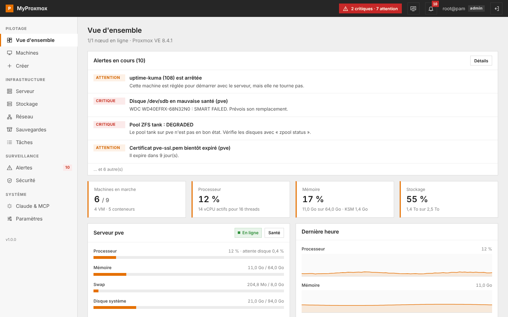

MyProxmox se branche sur l'API de ton serveur Proxmox et te donne une vue claire de ce qui s'y passe : l'état des machines, leurs adresses IP, la santé des disques, les sauvegardes manquantes, les tentatives de connexion suspectes. Il te prévient sur Discord, ntfy ou dans le navigateur quand quelque chose casse, peut rester affiché sur une TV en mode monitoring, et laisse Claude répondre à tes questions sur le serveur.

Il complète l'interface officielle sans la remplacer. Les réglages risqués (réseau, disques, permissions) restent dans Proxmox, où tu les fais en connaissance de cause.

## Sommaire

- [Fonctions](#fonctions)
- [Captures](#captures)
- [Installation](#installation)
- [Première configuration](#première-configuration)
- [Claude et MCP](#claude-et-mcp)
- [Écran de monitoring](#écran-de-monitoring)
- [Comptes MyProxmox](#comptes-myproxmox)
- [Alertes et notifications](#alertes-et-notifications)
- [Sécurité](#sécurité)
- [Variables d'environnement](#variables-denvironnement)
- [Mises à jour](#mises-à-jour)
- [Développement](#développement)
- [Feuille de route](#feuille-de-route)

## Fonctions

| | |
|---|---|
| Vue d'ensemble | CPU, RAM, swap, attente disque, charge, graphes de la dernière heure, plus gros consommateurs |
| Machines | Liste triable avec IP, nœud, tags, dernière sauvegarde ; actions groupées (démarrer, éteindre, redémarrer, snapshot, sauvegarde, migration, tags) ; arbre des ressources à gauche (serveurs, pools, tags) avec clic droit |
| Fiche machine | Tout ce que fait Proxmox : matériel complet (disques, CD, réseau, CPU, mémoire, UEFI, TPM, USB, PCI, série, audio, RNG, VirtIO-FS), Cloud-Init, options, ordre de boot, historique des tâches, notes en Markdown, snapshots en arbre, sauvegardes et restauration (fichiers isolés depuis PBS), réplication, migration, clonage, modèles, pare-feu, permissions, agent invité |
| Console | Écran des VM (noVNC) et terminal des conteneurs (xterm.js) directement dans MyProxmox, par un relais WebSocket authentifié |
| Création | Assistants complets VM et conteneur (avec récapitulatif), mode simple d'une page, création depuis un modèle |
| Serveur | Services système, santé SMART, usure des SSD, pools ZFS, mises à jour, certificats, DNS |
| Stockage | Occupation, contenu, téléchargement d'ISO et de modèles, estimation du remplissage |
| Réseau | Interfaces, ponts, inventaire des IP de toutes les machines, export CSV |
| Sauvegardes | Couverture par machine, tâches planifiées, snapshots oubliés |
| Sécurité | Comptes sans 2FA, jetons API, pare-feu, certificats, échecs de connexion par IP |
| Alertes | Règles réglables, cloche, notifications Windows, Discord, ntfy, webhook |
| Monitoring | Écran plein écran en lecture seule pour une TV, ouvert par un lien secret |
| MCP | 13 outils pour Claude, clés révocables en lecture ou en actions, journal |

Tout est organisé en modules (monitoring, alertes, MCP, sécurité, sauvegardes, mises à jour) que tu peux couper dans les paramètres.

### Ce que l'interface native ne montre pas

Ces informations existent dans l'API Proxmox, mais elles sont éparpillées dans plusieurs menus ou demandent une commande dans le shell :

- l'adresse IP de toutes les machines dans un seul tableau, avec les IP en double signalées ;
- les machines réglées pour démarrer avec le serveur mais arrêtées ;
- le ratio vCPU déclarés / threads physiques et RAM allouée / RAM physique ;
- le nombre de jours avant qu'un stockage soit plein, d'après la tendance de la semaine ;
- les machines qui ne sont dans aucune sauvegarde planifiée, ou pas sauvegardées depuis 7 jours ;
- les snapshots de plus de 30 jours, qui grossissent sans qu'on y pense ;
- les échecs de connexion lus dans le journal de `pvedaemon`, regroupés par adresse ;
- les mises à jour de sécurité en attente, séparées des autres.

## Captures

| | |
|---|---|
| 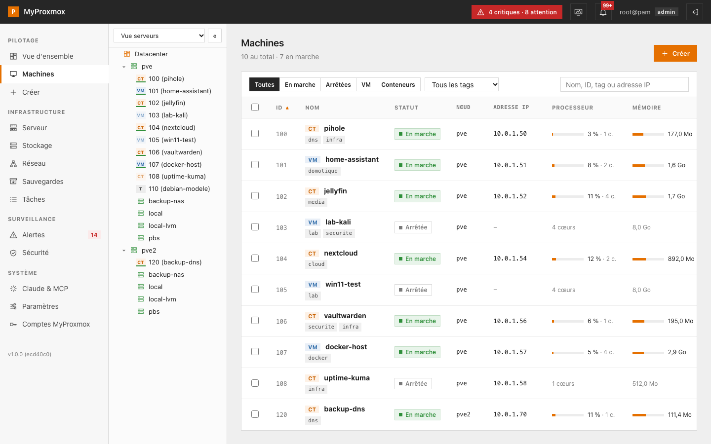 | 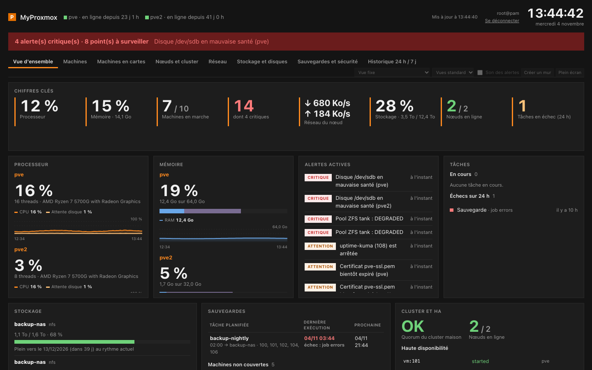 |
| Machines : IP, tags, dernière sauvegarde | Écran de monitoring pour une TV |
| 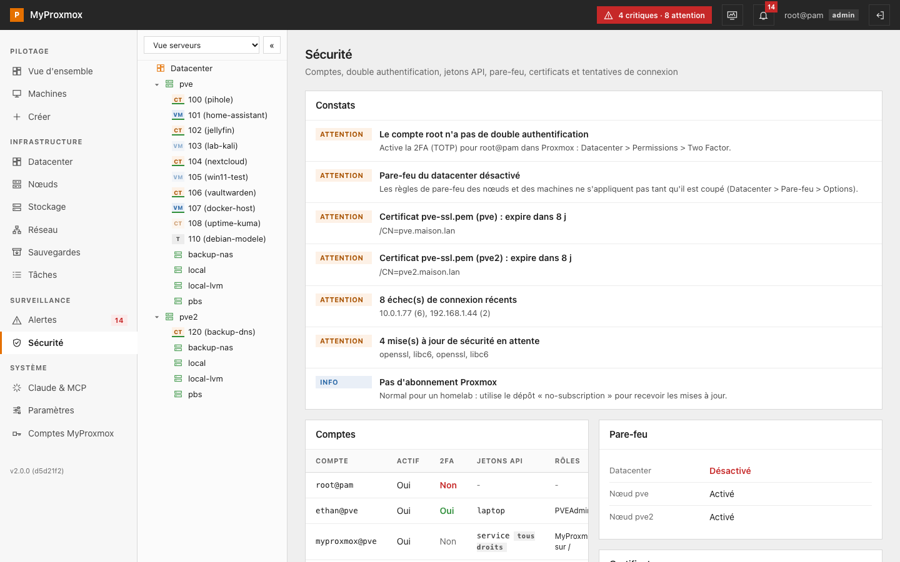 | 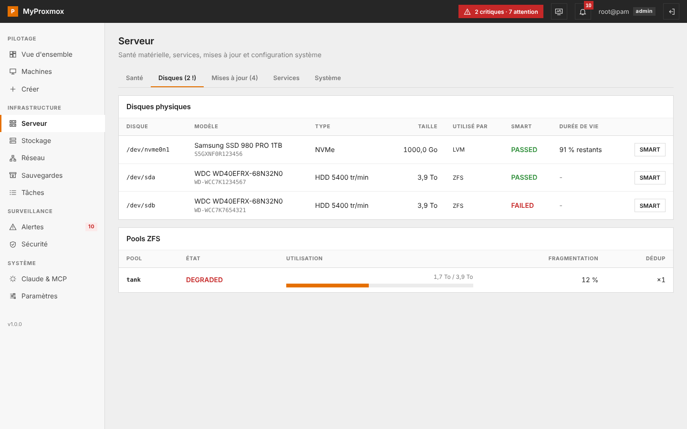 |
| Audit de sécurité | Santé SMART, usure des SSD, ZFS |
| 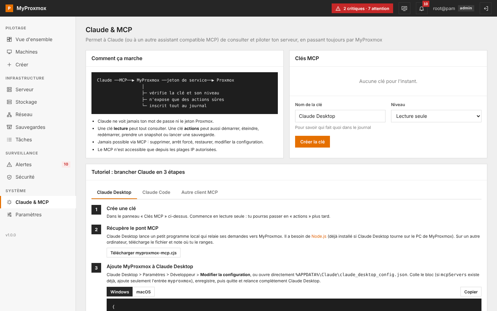 | 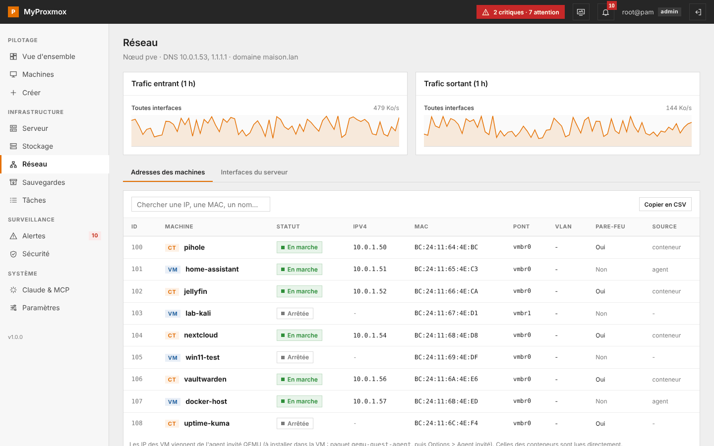 |
| Clés MCP et tutoriel | Inventaire réseau |
| 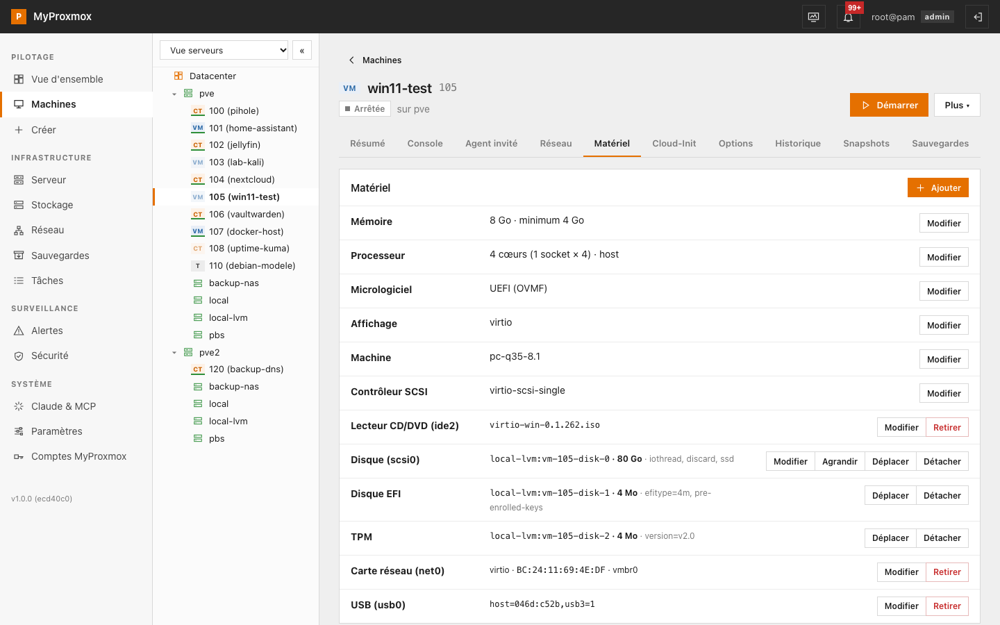 | 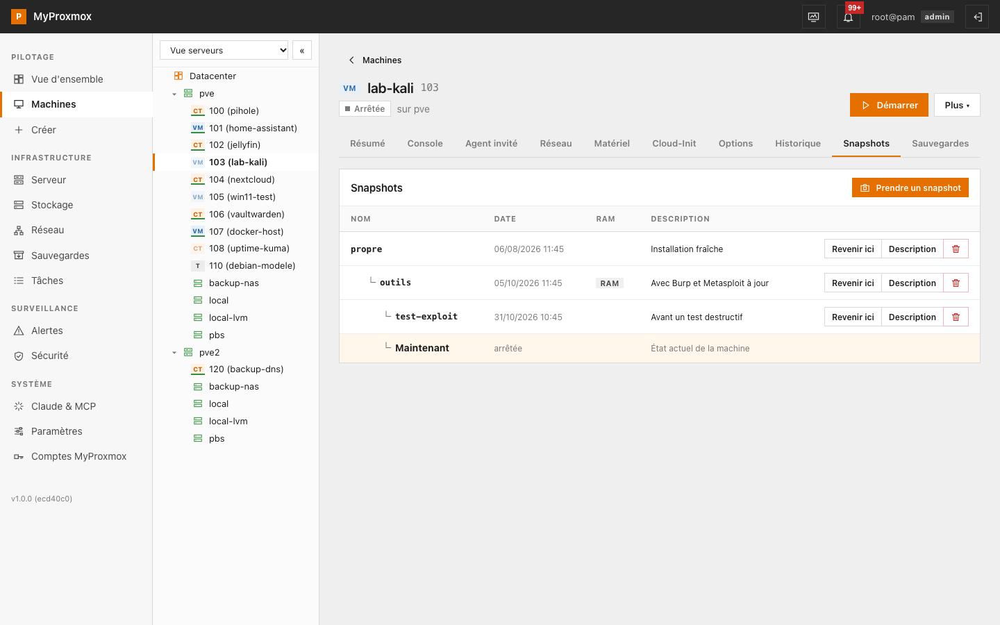 |
| Matériel d'une VM | Snapshots en arbre |
| 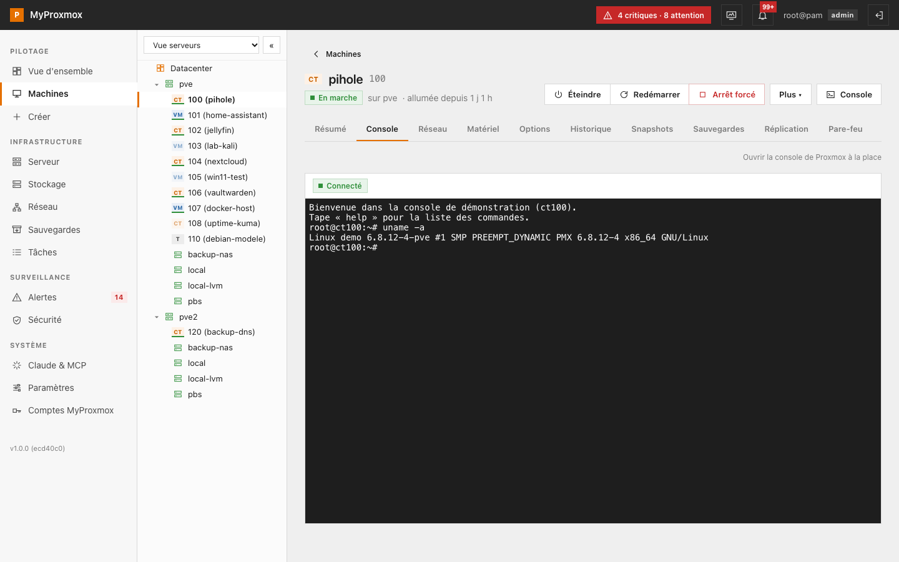 | 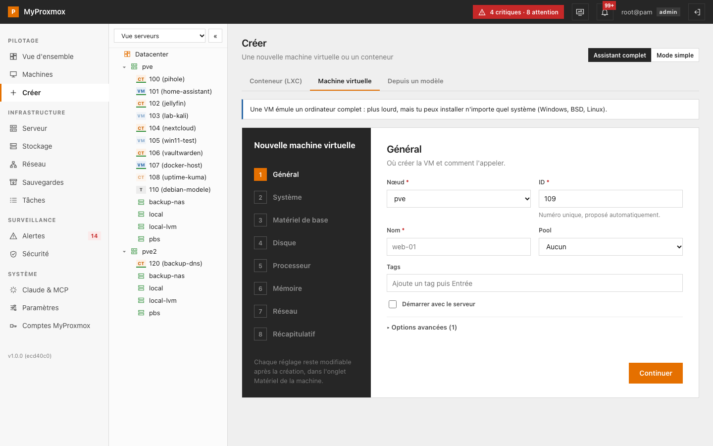 |
| Console intégrée | Assistant de création |

Les captures viennent du mode démo, avec de fausses données. Tu peux l'essayer [en ligne](https://myproxmox.vercel.app) ou en local (voir plus bas).

## Installation

MyProxmox tourne sur n'importe quel ordinateur de ton réseau qui voit le serveur Proxmox : un PC Windows qui reste allumé, un Raspberry Pi, un conteneur LXC sur le Proxmox lui-même, ou Docker. Il faut **Node.js 20 ou plus récent**.

### Windows

1. Installe [Node.js LTS](https://nodejs.org) (et [Git](https://git-scm.com/download/win) si tu veux des mises à jour plus rapides, c'est facultatif).
2. Récupère le projet : `git clone https://github.com/ethanfrq/MyProxmox.git`, ou [télécharge le zip](https://github.com/ethanfrq/MyProxmox/archive/refs/heads/main.zip) et décompresse-le, par exemple dans `C:\MyProxmox`.
3. Double-clique sur **`MyProxmox.bat`**. Au premier lancement, il installe les dépendances et compile l'app (2 à 5 minutes), puis ouvre le navigateur.

Pour qu'il se lance tout seul à chaque démarrage du PC, lance une fois `scripts\windows\autostart-on.bat`.

### Linux ou macOS

```bash
git clone https://github.com/ethanfrq/MyProxmox.git
cd MyProxmox
./start.sh
```

### Docker

```bash
git clone https://github.com/ethanfrq/MyProxmox.git
cd MyProxmox
docker compose up -d
```

La configuration est gardée dans `./data`. Le guide complet, avec l'installation dans un conteneur LXC et un service systemd, est dans [docs/INSTALL.md](docs/INSTALL.md).

### Essayer sans serveur Proxmox

```bash
npm ci && npm run build
npm run demo
```

Le mode démo utilise un faux Proxmox et ses propres données (`data-demo/`). N'importe quel identifiant Proxmox fonctionne. Côté comptes MyProxmox, essaie `tv-salon` (monitoring) ou `lea` (lecture), mot de passe `demo-monitoring`.

## Première configuration

Ouvre `http://adresse-du-pc:8080`. Un assistant te demande :

1. l'adresse de Proxmox (par exemple `https://10.0.1.101:8006`) et s'il faut accepter son certificat auto-signé ;
2. un compte administrateur, idéalement `root@pam` (la double authentification est prise en charge) ;
3. les plages d'adresses IP autorisées à ouvrir MyProxmox.

Avec ce compte, MyProxmox crée un rôle `MyProxmoxService`, un utilisateur `myproxmox@pve` et son jeton API. Le mot de passe n'est pas enregistré. Ce compte de service sert aux alertes, à l'écran de monitoring et au MCP ; il peut tout lire, démarrer et éteindre les machines, prendre des snapshots et lancer des sauvegardes, mais rien supprimer ni modifier de configuration.

Ensuite, chacun se connecte avec **son propre compte Proxmox** et retrouve exactement les droits qu'il a dans l'interface officielle.

## Claude et MCP

MyProxmox embarque un serveur [MCP](https://modelcontextprotocol.io) (transport Streamable HTTP, sur `/mcp`). Claude ne parle jamais directement à Proxmox : il passe par MyProxmox, qui vérifie sa clé, n'expose que des actions sûres et inscrit tout au journal.

```
Claude ──MCP──▶ MyProxmox ──jeton de service──▶ Proxmox
```

Les outils en lecture : `etat_general`, `lister_machines`, `details_machine`, `alertes_actives`, `sante_serveur`, `stockage`, `sauvegardes`, `securite`, `reseau`, `taches_recentes`. Avec une clé « actions » : `alimentation_machine` (démarrer, éteindre, redémarrer), `snapshot_machine`, `sauvegarder_machine`. Supprimer, forcer un arrêt ou restaurer reste impossible par MCP.

Mise en route rapide :

1. Dans MyProxmox, page **Claude & MCP**, crée une clé.
2. **Claude Code** : `claude mcp add --transport http myproxmox http://IP:8080/mcp --header "Authorization: Bearer mpx_..."`
3. **Claude Desktop** : colle dans `claude_desktop_config.json` le bloc généré par la page (il utilise le petit pont `bridge/dist/myproxmox-mcp.cjs`).

Le tutoriel pas à pas, avec des exemples de questions, est dans [docs/MCP.md](docs/MCP.md).

## Écran de monitoring

Dans **Paramètres > Écran de monitoring**, crée un lien secret et ouvre-le sur la TV (F11 pour le plein écran). L'écran est en lecture seule, garde l'affichage allumé, se recharge toutes les 6 h et reste lisible de loin en 1080p, 1440p et 4K (et sur une tablette en portrait). Un nouveau lien désactive l'ancien.

Ce qu'il affiche :

| Vue | Contenu |
|---|---|
| Vue générale | Chiffres clés, processeur (charge 1/5/15, attente disque, pression PSI), mémoire (utilisée, cache, libre, KSM, swap), alertes actives avec leur durée, nœuds (version, noyau, disque système, services critiques, mises à jour), stockage |
| Machines | Toutes les VM et conteneurs : statut, CPU avec mini graphe, RAM, débit réseau, uptime, IP, tags ; tri au choix, regroupement par tag ou par nœud |
| Réseau | Débit par pont et total des interfaces physiques, machines les plus actives, débit sur 24 h, quorum et ressources HA, activité en direct (tâches Proxmox, actions faites via MyProxmox et le MCP) |
| Stockage et disques | Occupation, date estimée de remplissage, stockages hors ligne, santé SMART, usure des SSD, température, lectures et écritures, pools ZFS |
| Sauvegardes et sécurité | Dernière et prochaine exécution de chaque sauvegarde planifiée, machines non couvertes, échecs de connexion sur 24 h, certificats qui expirent |
| Historique | CPU, RAM, réseau, attente disque et charge sur 24 h et 7 jours |

Les vues tournent toutes seules (15, 30 ou 60 s, ou vue fixe), avec une barre de progression. En alerte critique, le bandeau devient rouge et pulse, le widget concerné est encadré, et un son peut prévenir (désactivé par défaut, à activer écran par écran). Si les données ne sont plus fraîches, l'écran l'affiche clairement.

**Mode mur** : un administrateur choisit les widgets, leur ordre et leur taille sur une grille de 12 colonnes (bouton « Créer un mur », glisser-déposer). Chaque disposition a un nom et s'ouvre avec `?layout=nom`, par exemple `/monitoring?key=…&layout=salon`. Les dispositions sont enregistrées dans `data/monitoring-layouts.json`.

Côté performances, l'écran fait un seul appel à `/api/monitoring` toutes les 5 s ; l'historique, SMART, les sauvegardes et la sécurité sont gardés en cache par le serveur et rafraîchis toutes les 1 à 15 minutes.

| | |
|---|---|
| 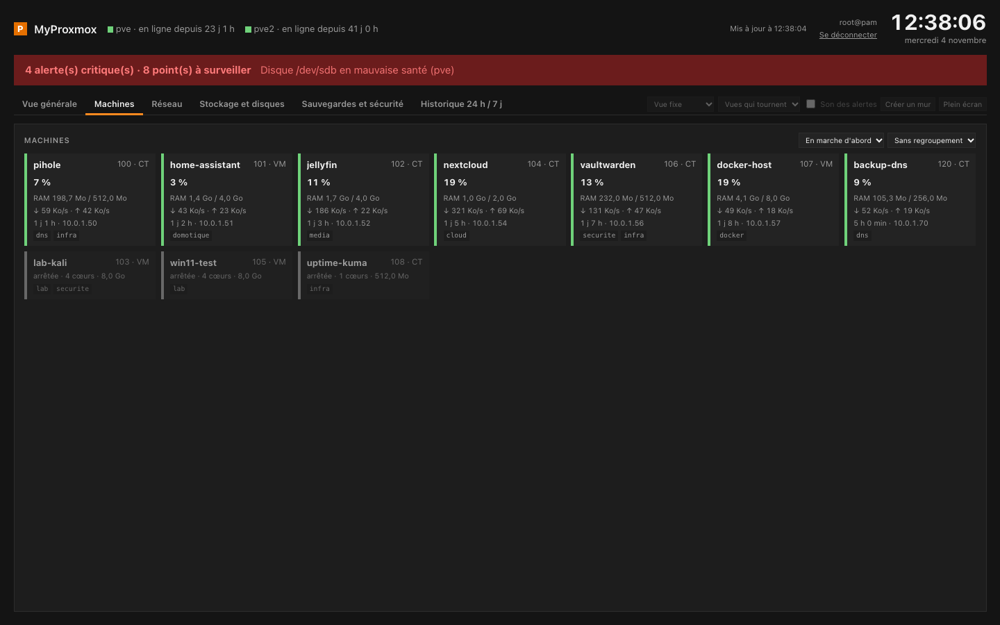 | 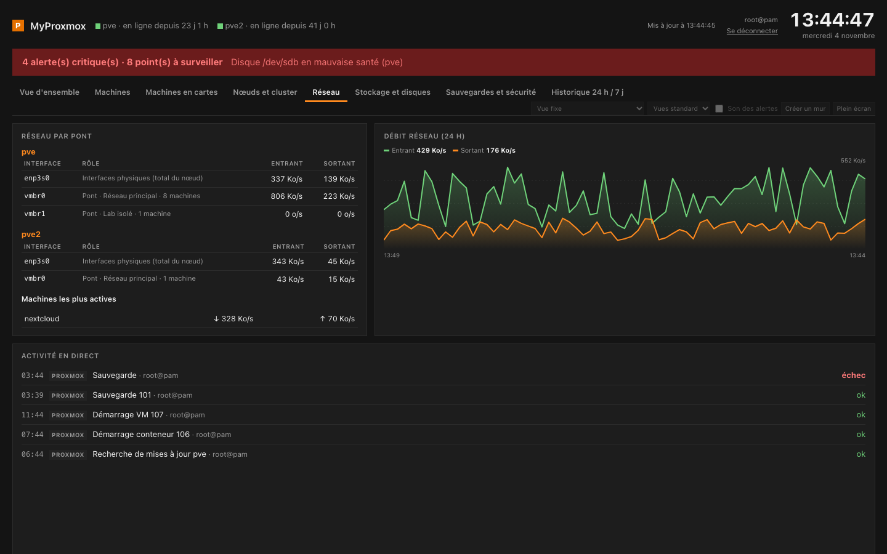 |
| 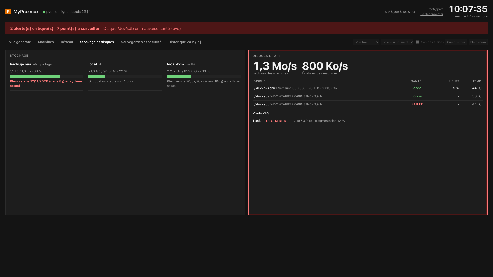 | 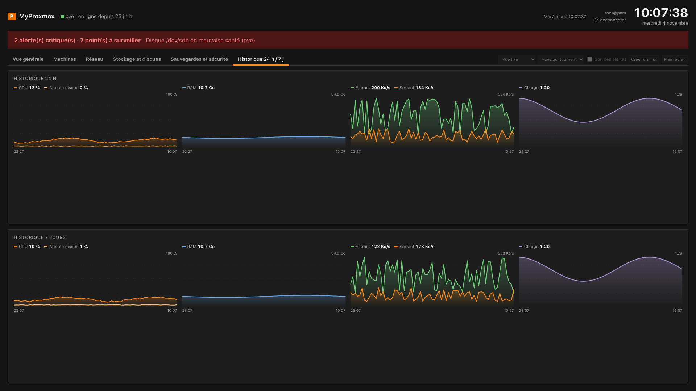 |

Tu peux aussi donner à quelqu'un un **compte MyProxmox** (voir plus bas) au rôle « monitoring » : il se connecte et arrive directement sur cet écran.

## Comptes MyProxmox

À côté des comptes Proxmox, MyProxmox gère ses propres comptes, sans rien créer dans Proxmox. Ils servent à regarder sans toucher :

| Rôle | Ce que la personne voit |
|---|---|
| Monitoring | L'écran de monitoring, et rien d'autre (pas de barre latérale, l'API refuse le reste avec une erreur 403) |
| Lecture | Toutes les pages, sans aucune action possible |

Ces comptes lisent Proxmox avec le compte de service. Ils se gèrent dans **Paramètres > Comptes MyProxmox** : création, validation des inscriptions, changement de rôle, désactivation, nouveau mot de passe, suppression. L'inscription libre est fermée par défaut ; tu peux l'ouvrir avec validation par un administrateur (une notification arrive alors à chaque demande) ou sans validation (rôle monitoring seulement). Chaque personne peut activer la double authentification (TOTP) depuis **Mon compte**.

## Alertes et notifications

Le serveur vérifie Proxmox toutes les minutes (disques, sauvegardes et mises à jour toutes les 15 minutes) :

| Alerte | Niveau |
|---|---|
| Nœud hors ligne, stockage indisponible | critique |
| Disque SMART en défaut, pool ZFS dégradé | critique |
| Sauvegarde en échec | critique |
| CPU ou RAM au-dessus du seuil pendant plusieurs minutes | attention |
| Stockage ou disque système presque plein | attention, puis critique |
| Machine en démarrage auto mais arrêtée | attention |
| Machine sans sauvegarde récente | attention |
| Certificat qui expire bientôt, SSD usé | attention |
| Mises à jour disponibles | info |

Les seuils se règlent dans **Alertes > Règles**. Les notifications arrivent dans l'app (cloche et bandeau), en notification Windows si l'onglet est ouvert, et sur Discord, [ntfy](https://ntfy.sh) ou n'importe quel webhook, avec une notification « résolu » quand le problème disparaît.

## Sécurité

- Le navigateur ne voit jamais de jeton Proxmox : il reçoit un cookie de session `HttpOnly`, et le ticket reste côté serveur.
- Tout est filtré par plage IP, MCP et monitoring compris. Le PC qui héberge l'app garde toujours l'accès en local.
- Les clés MCP et le lien de monitoring ne sont stockés que sous forme d'empreinte SHA-256.
- Les mots de passe des comptes MyProxmox sont hachés avec scrypt (sel par compte) : 10 caractères minimum, les 1000 mots de passe les plus courants refusés, 5 échecs par minute et par IP au plus.
- L'assistant de configuration se verrouille une fois terminé.
- Le site envoie `X-Robots-Tag: noindex` et un `robots.txt` qui bloque l'indexation.

À savoir : le secret du jeton de service est enregistré en clair dans `data/config.json`, et l'app parle en HTTP sur ton réseau local. Ne l'expose pas sur Internet sans reverse proxy HTTPS. Les détails et la façon de signaler une faille sont dans [SECURITY.md](SECURITY.md).

## Variables d'environnement

| Variable | Par défaut | Rôle |
|---|---|---|
| `PORT` | `8080` | Port d'écoute |
| `HOST` | `0.0.0.0` | Interface d'écoute (`127.0.0.1` pour ce PC seulement) |
| `MYPROXMOX_DATA` | `./data` | Dossier de la configuration, des notifications et du journal |
| `MYPROXMOX_DEMO` | | `1` pour le mode démo avec un faux Proxmox |
| `MYPROXMOX_BRANCH` | `main` | Branche suivie par la mise à jour automatique |
| `TRUST_PROXY` | | `1` derrière un reverse proxy, pour lire l'IP dans `X-Forwarded-For` |

## Mises à jour

`MyProxmox.bat` et `start.sh` récupèrent la dernière version sur GitHub à chaque lancement, puis recompilent si quelque chose a changé. Avec un dossier cloné par git, c'est un `git pull` en avance rapide ; sans git, Windows télécharge le zip et remplace les fichiers sans toucher à `data/`. Si GitHub ne répond pas, l'app démarre avec la version installée.

- Forcer une mise à jour : `Mettre-a-jour.bat`
- Désactiver la mise à jour automatique : crée un fichier vide `data/no-auto-update`
- Lancer sans mise à jour : `MyProxmox.bat --no-update`

## Développement

```bash
npm ci
npm run dev        # serveur en mode démo + Vite sur http://localhost:5173
npm run typecheck
npm run build      # web/dist, server/dist, bridge/dist
npm run build:demo # vitrine + démo statique (web/dist-demo), celle publiée sur Vercel
npx playwright test # parcours de bout en bout en mode démo (lance le serveur tout seul)
```

```
shared/   code commun au serveur et au navigateur : faux Proxmox, calculs, règles d'alerte
server/   Express : connexion Proxmox, filtre IP, passerelle API, alertes, MCP
bridge/   pont MCP stdio vers HTTP pour Claude Desktop
web/      React + Vite : l'interface, l'écran de monitoring, la démo et la vitrine
scripts/  compilation, lanceurs Windows (mise à jour, démarrage automatique)
```

La pile : React 19, React Router, Vite, Express 5, le SDK MCP officiel en TypeScript, esbuild. Aucune base de données : la configuration tient dans des fichiers JSON.

## Feuille de route

- Interface en anglais (les textes sont en français pour l'instant)
- Plusieurs serveurs Proxmox et clusters dans une même interface
- Prise en charge de Proxmox Backup Server
- Validation dans l'interface des actions demandées par Claude
- Graphiques sur 7 et 30 jours
- Image Docker publiée sur GHCR

Les idées et les contributions sont bienvenues, voir [CONTRIBUTING.md](CONTRIBUTING.md).

## Licence

[MIT](LICENSE). MyProxmox est un projet indépendant, sans lien avec Proxmox Server Solutions GmbH. Proxmox est une marque déposée de Proxmox Server Solutions GmbH.

---

## In English

MyProxmox is a self-hosted web dashboard for Proxmox VE. It adds what the stock UI keeps buried in menus (every guest IP in one table, SMART health and SSD wear, guests that should be running but aren't, backup coverage, storage fill-up forecasts, failed logins grouped by IP), sends alerts to Discord, ntfy, webhooks or browser notifications, provides a read-only full-screen monitoring view for a wall display, and ships an MCP server so Claude can answer questions about your homelab and, if you allow it, start, stop or snapshot guests.

You log in with your own Proxmox account (2FA supported). Access is restricted to IP ranges you choose. Run it with `MyProxmox.bat` on Windows, `./start.sh` on Linux/macOS, or `docker compose up -d`, then open `http://your-pc:8080`. The UI is in French for now; an English translation is on the roadmap. Licensed under MIT.
